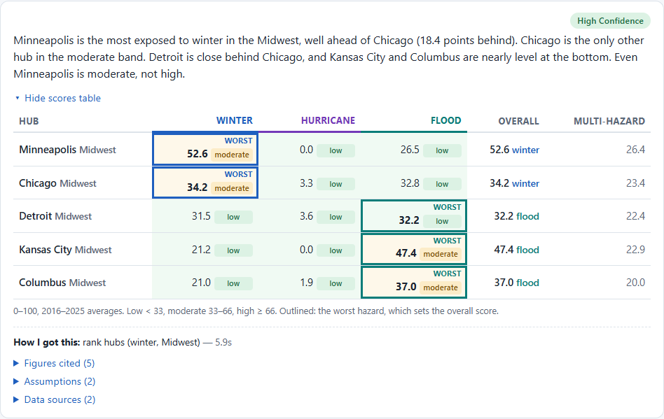
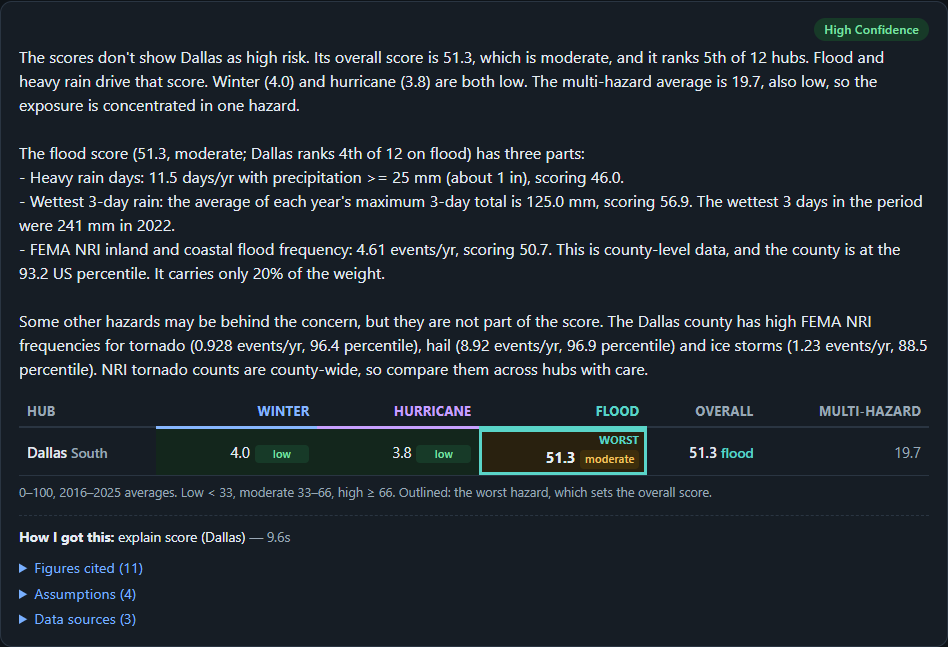
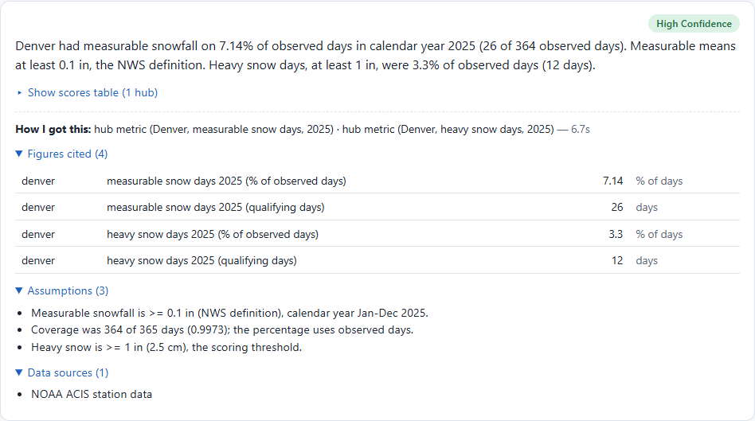

# Weather Risk Intelligence Agent

A chat agent that helps a US logistics company decide **which distribution hubs are most exposed to
weather disruption** and should get resilience investment. It scores 12 hubs on winter, hurricane and
flood exposure from 10 years of measured weather data and FEMA's National Risk Index, and answers
analysts' questions with the scores, the reasoning behind them and the assumptions they rest on.

**Code computes, the LLM explains.** Every number, score and ranking comes from deterministic Python
over stored data. Claude only chooses tools and explains their results — and the backend checks that
every number in an answer was actually returned by a tool.

It answers the client's example questions:

- *Which hubs in the Midwest are most exposed to winter disruption?*
- *Compare Miami and Houston in terms of hurricane and flood exposure.*
- *What percentage of days in Denver last year had snowfall?*
- *Why is the Dallas hub's weather disruption risk high?* — it is not: Dallas scores moderate, and the
  agent says so, shows the breakdown, and points to tornado and hail data that the score does not cover.

| Ranking with the scores table | False premise (Dallas), dark theme |
|---|---|
|  |  |



More in [`docs/screenshots/`](docs/screenshots/README.md). Note: `07-warning-MOCKED-light.png` there is a
**mocked response, not a real answer** — it was created in the browser only to show how the "check these
numbers" warning looks.

## How to run

**Needs:** Python 3.12, Node.js 20.19+ or 22.12+, an Anthropic API key, internet access (for ingestion and the Claude API).

**Setup (once)**
```bash
python -m venv .venv
source .venv/bin/activate            # Windows: .venv\Scripts\activate
python -m pip install -r requirements.txt
cp .env.example .env                 # Windows: copy .env.example .env — then set ANTHROPIC_API_KEY
cd frontend && npm install && cd ..
```

**One command per part** (from the repo root, virtualenv active)

| Part | Command | Notes |
|---|---|---|
| Ingestion | `python -m backend.ingestion.run` | Builds `data/weather.db` (~15 s). Safe to re-run. |
| Backend | `python -m uvicorn backend.app:app --port 8000` | `GET /health`, `POST /chat` |
| Frontend | `cd frontend && npm run dev` | Open http://localhost:5173 (proxies to the backend) |
| Eval | `python eval/run_eval.py` | 19 cases, ~1 min, ~$0.25 of API usage |
| Eval, dry run | `python eval/run_eval.py --dry-run` | Free: shows every expected value, no API calls |
| Tests | `python -m pytest` | 70 tests, no API calls |

Without the UI: `python scripts/ask.py "Which hubs in the Midwest are most exposed to winter disruption?"`.
The model is set in `.env` (`AGENT_MODEL`, default `claude-sonnet-5-5`; `claude-opus-5-5` also works).

These steps were tested from a fresh clone. `python -m …` is used throughout because it also works where
security policies block the small `pip.exe` / `pytest.exe` launchers. If answers say "No Anthropic API key",
set `ANTHROPIC_API_KEY` in `.env` and restart the backend; `GET /health` shows `api_key_set`.

## How it works

```
NOAA ACIS station data ─┐
Open-Meteo wind gusts ──┼─► ingestion ─► SQLite ◄── tools ◄── agent loop ◄──► Claude API
FEMA National Risk Index┘                            ▲            ▲
                                       scoring code ─┘     FastAPI /chat ◄── React chat UI
```

- **Data**: daily snowfall, minimum temperature and precipitation measured at each hub's airport
  weather station (NOAA ACIS, 2016–2025) — chosen over modelled data, which missed most extreme days —
  plus FEMA National Risk Index county frequencies for winter weather, hurricane and flood.
- **Scores**: each metric is mapped to 0–100 with fixed anchors at US extremes (so scores don't depend on
  which hubs were picked); hazard score = weighted metrics; **overall score = the worst hazard**, because a
  hub closes when one hazard hits it. Levels: low < 33, moderate 33–66, high ≥ 66.
- **Agent**: Claude (Sonnet 5.5 by default) with 5 data tools and a structured final answer, validated
  in the backend; numbers that no tool returned are flagged and shown as a warning in the UI.
- **Eval**: 19 cases — the client's questions, follow-ups, ties, false premises, out-of-scope questions
  and a prompt injection — all checked by code. **19/19 pass** on Sonnet 5.5 (median 5.7 s per answer).
- **Cost**: about **$0.01 per answer** on Sonnet 5.5 (the full eval is $0.23 for 21 questions): under a
  cent when no data lookup is needed, up to ~2 cents for comparisons and "why" answers. Opus 5.5 is ~3× that.

Full design: **[docs/ARCHITECTURE.md](docs/ARCHITECTURE.md)** — components, repository structure, storage,
data sources, scoring tables, agent guarantees, evaluation results and the decisions log.

## Assumptions & limitations (summary)

The client asked for assumptions and uncertainty to be clear, so the main ones are here; the full list is
in [ARCHITECTURE.md § 10](docs/ARCHITECTURE.md#10-assumptions-uncertainty-and-limitations).

- **The hub list is assumed** (none was provided): 12 hubs, each placed at its main-airport NWS weather
  station, not at a real warehouse address. Replace `data/hubs.json` and re-run ingestion to use real sites.
- **Thresholds and weights are expert assumptions, not calibrated** to the client's disruption history
  (e.g. ≥ 1 in of snow, ≥ 25 mm of rain, ≤ −15 °C). All of them live in one file,
  `backend/scoring/config.py`, with the reasoning for each.
- **Three hazards are scored** (winter, hurricane, flood). Tornado, hail and ice storm are shown as
  context only. No seasonal scores, forecasts or financial losses — the agent says so instead of guessing.
- **FEMA NRI is county-level and long-term.** For large counties it can overstate a hazard at the hub
  (Phoenix flood); it has a low weight there and the agent states the caveat.
- **Wind gusts are modelled data**, too smooth to measure hurricanes, so they are not scored.
- **Overall = worst hazard** ignores breadth of exposure; the multi-hazard average is shown next to it.
- **"Last year" = calendar year 2025.** Missing station days are excluded, never counted as zero
  (coverage ≥ 97 % for every hub).
- **The API has no authentication or rate limiting**, so anyone who can reach it can use it and spend the
  API credit behind it. It is for local use and **not ready for public exposure as-is**.
- Open-Meteo's free tier is for non-commercial use. Sessions are kept in memory. Not deployed.

## How I worked

This was built with Claude Code in one day, in reviewed stages:

1. **[CLAUDE.md](CLAUDE.md)** — the brief and working rules I wrote first: scope, the "code computes, the
   LLM explains" principle, data sources to verify, and "never start the next stage before I approve".
   It was updated as decisions changed what we were building.
2. **A full plan before any code** — files per stage, main decisions, risks and how each stage would be
   checked; Claude was asked to challenge the brief, which led to the biggest changes (station data instead
   of modelled data, NRI frequency instead of NRI risk scores, a 10-year window).
3. **Seven stages, each ending with a check and my approval**: data check → ingestion → scoring → agent →
   chat UI → evaluation → docs. One git commit per stage. (An eighth, bonus stage — score-change
   alerts — was planned but not built.)
4. **Decisions with evidence**: I verified key facts independently (Denver's snowfall days on NWS NOWData,
   the FEMA data source on ArcGIS) and changed course when the data said so — e.g. the overall score became
   the worst hazard, and a planned county-area correction was dropped after a check across all US counties.
   Every decision is in the [decisions log](docs/ARCHITECTURE.md#11-decisions-log).
5. **API spend was planned**: the eval and the model comparison were estimated before running and cost $0.98.

The full Claude Code sessions are exported in **[docs/sessions/](docs/sessions/)**: part 1 is the plan and
the review of CLAUDE.md; part 2 covers stages 1–6.

## Repository

```
backend/    FastAPI app, agent loop, tools, scoring, ingestion, SQLite schema
frontend/   React + TypeScript chat UI (Vite, no UI library)
data/       hubs.json (assumed hub list), raw/ (FEMA NRI snapshot)
eval/       cases.yaml, run_eval.py, results/ (saved runs with every answer)
tests/      70 pytest tests
scripts/    data check, data report, score table, command-line client
docs/       ARCHITECTURE.md, screenshots/, sessions/
```
